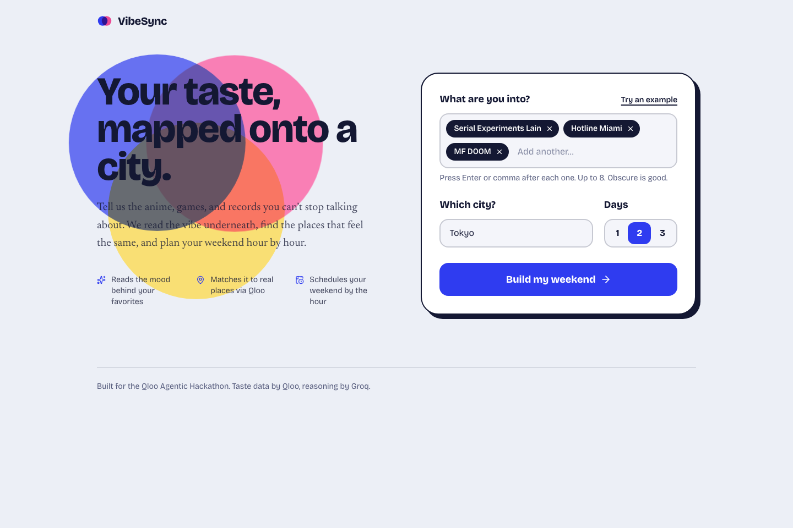
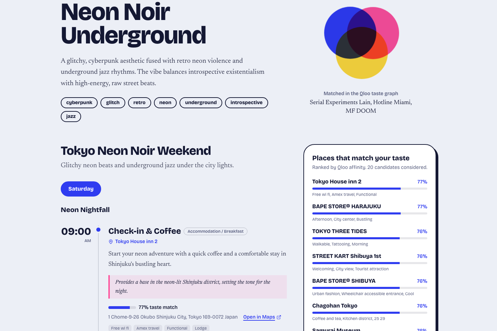
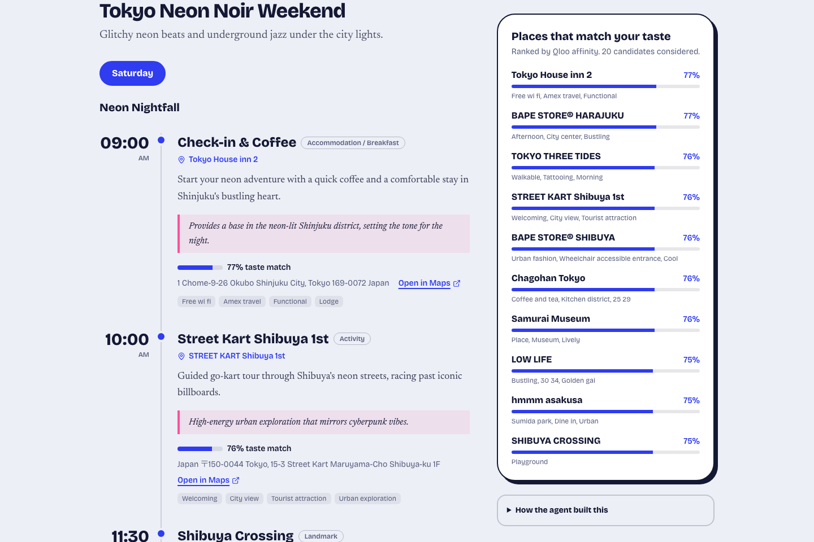
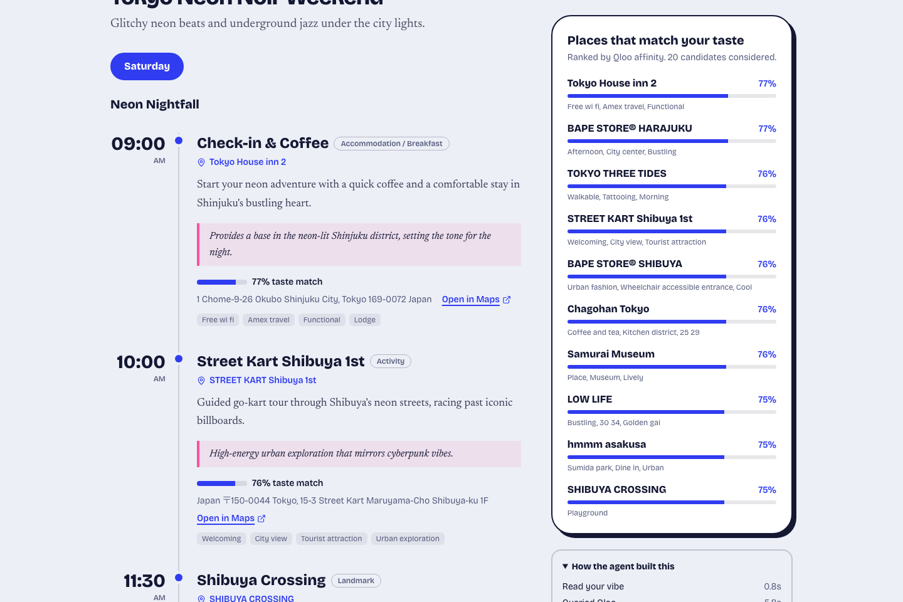

<div align="center">

# VibeSync Itinerary

**Your taste, mapped onto a city.**

[](./LICENSE)
[](https://nodejs.org)
[](https://react.dev)
[](https://vitejs.dev)
[](https://tailwindcss.com)
[](https://groq.com)
[](https://qloo.com)

</div>

---

## The Problem

Every travel app recommends the same places to everyone. "Top 10 things to do in Tokyo" is the same list whether you're into jazz, anime, or noise music. VibeSync is different: it reads the **vibe underneath your specific taste** — the anime you watch, the games you play, the records you loop — and plans a weekend around the places that **feel the same** to you.

---

## Screenshots

| Landing page (form filled with example) | Vibe title, summary, keywords |
|---|---|
|  |  |

| Day 1 timeline with taste-match bars | Places panel + "How the agent built this" |
|---|---|
|  |  |

> **Demo video:** https://vibesync-itinerary.vercel.app

---

## How It Works

VibeSync is a 6-step agentic pipeline:

```
1. EXTRACT VIBE   Groq (LLM) reads your favorites and extracts a structured "vibe":
                  title, summary, 5-8 keywords, canonical entity names, and preferred atmospheres.

2. RESOLVE        Each favorite (and each qloo_entity from the vibe) is resolved to a
                  real Qloo entity via POST /search — turning "MF DOOM" or
                  "Serial Experiments Lain" into a stable Qloo entity ID.

3. TASTE-MATCH    Qloo /v2/insights is called with:
                    signal.interests.entities = resolved entity IDs
                    filter.type              = urn:entity:place
                    filter.location.query   = target city
                  This returns taste-matched physical places ranked by affinity score.

4. RANK & DIVERSIFY  Places are sorted by affinity score, then round-robin bucketed
                     by primary tag (bar, cafe, cinema…) so the schedule is varied.

5. COMPOSE        Groq composes the itinerary JSON using ONLY the retrieved places
                  (referenced by ID / ref). Generic fillers are limited to 1 per day.

6. GROUND         Every stop is matched back to its Qloo place record. The result
                  carries from_qloo: true, the real place ID, address, coordinates,
                  affinity score, and rating — zero invented places.
```

### How Qloo Is Used

Qloo's **cross-domain affinity** API maps **media taste** (anime, games, music) to **physical places** (restaurants, bars, cinemas, galleries). VibeSync seeds the query with the user's resolved cultural interests and lets Qloo's taste graph surface the places that people with exactly that sensibility tend to love — then schedules them hour-by-hour.

---

## Features

- 🎭 **Taste extraction** — Groq reads vibe, mood, and atmosphere from your favorites
- 📍 **Grounded results** — every itinerary stop is tied to a real Qloo place with coordinates and affinity score
- 🗂 **Diversified schedule** — round-robin across category buckets prevents 8 bars in a row
- 📊 **Taste-match bars** — each stop shows the Qloo affinity percentage
- 🔍 **Agent trace** — expand "How the agent built this" to see each step and its latency
- 📋 **Copy plan** — one-click plain-text copy of the full schedule
- 🛡 **Rate limiting** — built-in per-IP rate limiter protects Groq quota
- 🧪 **Mock mode** — run without a Qloo key using `USE_MOCK_QLOO=true`

---

## File Tree

```
vibesync-itinerary/
├── assets/
│   └── screenshots/
│       ├── 01-hero.png
│       ├── 02-vibe.png
│       ├── 03-itinerary.png
│       └── 04-places-and-trace.png
├── backend/
│   ├── src/
│   │   ├── config.js                  # Env var loading and validation
│   │   ├── services/
│   │   │   ├── agent.js               # Orchestrator: vibe → Qloo → itinerary
│   │   │   ├── llm.js                 # Groq JSON-mode client with retry logic
│   │   │   ├── qlooClient.js          # Real Qloo API client (search + v2/insights)
│   │   │   └── qlooMock.js            # Mock Qloo provider for offline dev
│   │   └── utils/
│   │       └── helpers.js             # AppError, UpstreamError, sleep, slugify
│   ├── check-qloo.mjs                 # CLI sanity-check for the Qloo API key
│   ├── server.js                      # Express app, routes, rate limiter
│   ├── .env.example                   # Environment variable template
│   └── package.json
├── frontend/
│   ├── src/
│   │   ├── components/
│   │   │   ├── Dashboard.jsx          # Results: vibe card, timeline, places panel, trace
│   │   │   ├── Hero.jsx               # Landing form (favorites, city, days)
│   │   │   ├── Loading.jsx            # Animated loading state
│   │   │   └── OverprintMark.jsx      # Decorative SVG mark
│   │   ├── lib/
│   │   │   └── api.js                 # fetch wrapper for /api/itinerary
│   │   ├── App.jsx                    # Root: idle / loading / done state machine
│   │   ├── index.css                  # Tailwind base + custom tokens
│   │   └── main.jsx                   # React DOM entry
│   ├── index.html
│   ├── vite.config.js                 # Vite + proxy to backend :5001
│   └── package.json
├── .gitignore
├── LICENSE
└── README.md
```

---

## Tech Stack

| Layer | Technology | Purpose |
|---|---|---|
| **Frontend** | React 18, Vite 5, Tailwind CSS 4 | UI, build tooling, styling |
| **Backend** | Node.js 18+, Express 4 | REST API, rate limiting, orchestration |
| **LLM** | Groq (`llama-3.3-70b-versatile`, fallback `llama-3.1-8b-instant`) | Vibe extraction, itinerary composition |
| **Taste graph** | Qloo Hackathon API (`/search`, `/v2/insights`) | Cross-domain affinity, place discovery |
| **Dev tools** | nodemon, ESM modules | Hot reload, modern JS |

---

## Quickstart

```bash
# 1. Clone
git clone https://github.com/Soham-Saha-dev02/vibesync-itinerary.git
cd vibesync-itinerary

# 2. Install dependencies
cd backend  && npm install
cd ../frontend && npm install

# 3. Configure environment
cd ../backend
cp .env.example .env
# Edit .env and fill in GROQ_API_KEY and QLOO_API_KEY

# 4. Start both servers (two terminals)
# Terminal 1 – backend (port 5001):
cd backend  && npm run dev

# Terminal 2 – frontend (port 5173):
cd frontend && npm run dev

# 5. Open http://localhost:5173
```

---

## Environment Variables

All variables live in `backend/.env`. Copy `backend/.env.example` to get started.

| Variable | Default | Description |
|---|---|---|
| `PORT` | `5000` | Backend listen port |
| `CLIENT_ORIGIN` | `http://localhost:5173` | Allowed CORS origin(s), comma-separated |
| `GROQ_API_KEY` | *(required)* | Your Groq API key |
| `GROQ_MODEL` | `llama-3.3-70b-versatile` | Primary Groq model |
| `GROQ_FALLBACK_MODEL` | `llama-3.1-8b-instant` | Fallback if primary is rate-limited |
| `USE_MOCK_QLOO` | `false` | Set `true` to skip Qloo and use sample data |
| `QLOO_FALLBACK_TO_MOCK` | `false` | Degrade to mock if a Qloo call fails |
| `QLOO_BASE_URL` | `https://hackathon.api.qloo.com` | Qloo API base URL |
| `QLOO_API_KEY` | *(required unless `USE_MOCK_QLOO=true`)* | Your Qloo API key |
| `QLOO_CACHE_TTL_MS` | `600000` | TTL for Qloo response cache (10 min) |
| `QLOO_EXPLAINABILITY` | `false` | Enable Qloo explainability feature flag |

> **Mock mode:** Set `USE_MOCK_QLOO=true` to run entirely offline without a Qloo key. The places panel will show a yellow "Sample data" banner and every place will be tagged "Demo place". Live mode requires a valid `QLOO_API_KEY`.

---

## Verifying Your Qloo Setup

`backend/check-qloo.mjs` is a standalone CLI script that calls both Qloo endpoints and prints a coverage table — useful for confirming your API key and base URL before running the full app:

```bash
# From the backend directory:
node check-qloo.mjs Tokyo "MF DOOM" "Hotline Miami" "Serial Experiments Lain"
```

It resolves each name via `/search`, fetches places via `/v2/insights`, and reports field coverage (name, address, affinity, lat, etc.).

---

## Troubleshooting

| Symptom | Likely cause | Fix |
|---|---|---|
| `[FATAL] Missing environment configuration: GROQ_API_KEY` | `.env` not created or key missing | Copy `.env.example` → `.env`, add `GROQ_API_KEY` |
| `[FATAL] Missing environment configuration: QLOO_API_KEY` | Qloo key missing and mock not enabled | Add `QLOO_API_KEY` or set `USE_MOCK_QLOO=true` |
| "Qloo could not recognize any of those favorites" | Entity names misspelled or too niche | Try more canonical spellings; add more mainstream titles |
| "Qloo returned no places for …" | City too small or not indexed | Try a major city: Tokyo, New York, London, Berlin |
| 429 from the itinerary endpoint | Per-IP rate limit hit (8 req/min) | Wait 60 s; the backend enforces this to protect Groq quota |
| Yellow "Sample data" banner in results | `USE_MOCK_QLOO=true` or Qloo degraded | Check `QLOO_API_KEY` and `/api/health` → `qloo.mode` |
| Backend starts on port 5001 instead of 5000 | `PORT` in `.env` is set to 5001 | Adjust `PORT` in `.env` or update `vite.config.js` proxy |
| Frontend cannot reach backend | Wrong port in Vite proxy | Check `vite.config.js` `server.proxy` target matches backend port |

---

## Roadmap

- [ ] Map view: pin itinerary stops on an interactive map
- [ ] Multi-city comparison: same vibe, different cities side-by-side
- [ ] Export to Google Calendar / Apple Maps
- [ ] Saved itineraries: local storage persistence
- [ ] Shareable links: encoded itinerary in URL
- [ ] Additional LLM provider support (OpenAI, Anthropic)

---

## License

[MIT](./LICENSE) © 2026 Soham Saha
